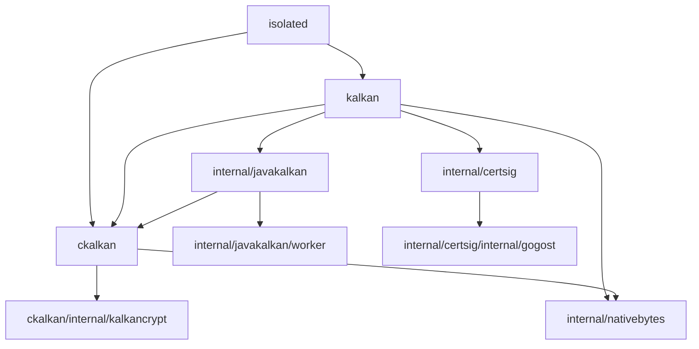

# Architecture

This module is a library, with three intentionally public Go packages and no
standalone executable. Applications own startup, worker entry points and key
selection. There are no third-party Go module requirements in `go.mod`; the
proprietary native library and Java JARs are supplied at runtime.

## Package ownership

```text
kalkan/                              typed application API and shared input policy
├── ckalkan/                         public native SDK binding and process-wide serialization
│   └── internal/kalkancrypt/        private platform drivers and ABI calls
├── isolated/                        public native worker process client and RunWorker
└── internal/
    ├── javakalkan/                  Java adapter, subprocess lifetime, IPC and HTTP
    │   └── worker/                  embedded Java sources and source-tree preparation
    │       └── src/kalkan/worker/   Java keys, trust, CMS, XML, OCSP, CRL and timestamps
    ├── certsig/                     Go certificate and OCSP signature verification
    │   └── internal/gogost/         retained upstream verification primitives
    ├── nativebytes/                 shared native text terminator handling
    └── testfixture/                 test-only SDK assets and independent fixture parsing
```

`internal` directories enforce implementation visibility. In particular, the
native driver is private to `ckalkan`, and the retained GoGOST primitives are
private to `certsig`. The source layout under `worker/src/kalkan/worker` follows
Java package names and the embedded compiler's source layout. These levels do
not introduce extra Go dispatch layers.

The production dependencies are:



`testfixture` has no production callers. The Java adapter deliberately uses
`ckalkan` request, flag and result types as the existing SDK-shaped operation
contract. It does not load a native library. Introducing another shared public
model package would add conversions and a new contract without removing the
existing public types.

## Root client and backend boundary

`Open` applies options, validates configuration, creates a backend, initializes
it and loads explicitly trusted certificates. Failed setup closes the created
session. Each `Client` owns a call gate, diagnostics and a small certificate PEM
cache. The backend owns SDK state and successfully loaded trust.

- `backend.go` defines session ownership and the operation capabilities consumed
  by the root API. Runtime capability checks preserve explicit unsupported
  operation errors and allow focused test fakes.
- `backend_native.go` opens `ckalkan`, restores trust after key-store changes and
  supplies native chain validation with an optional trust snapshot for Go OCSP.
- `backend_java.go` configures the Java adapter, binds a context to each operation
  and translates Java input errors to the public input-error sentinel.
- `ocsp_client.go` consumes the chain-validation capability under the client call
  gate. It does not inspect native backend fields. The native implementation
  forces revocation off for this step; authenticated OCSP HTTP runs in Go after
  the gate is released.

The root API is organized by cryptographic operation rather than technical
layers. Public requests and results stay with their consumers. Shared `Source`
values describe presence, encoding and ownership; they do not read CMS files.

- `cms.go` coordinates signing and verification; `cms_input.go` owns CMS input
  normalization and bounded CMS file reads, including inputs used for certificate
  and timestamp extraction.
- `xml.go` coordinates XML/WS-Security operations and SDK flag conversion;
  `xml_policy.go` owns XML structure, SOAP binding and permitted transforms.
- `zip.go` coordinates ZIP operations; `zip_policy.go` owns output validation and
  atomic publication.
- Certificate metadata, certificate parsing, endpoint policy, limits and
  diagnostics have their own existing cohesive files in the same package.

These are file-level responsibility boundaries, not new packages. Keeping them
in the root package preserves request types, errors and methods without adapter
layers or duplicate models.

## Native runtime

`ckalkan` owns the single active native client slot, process-wide mutex, status
conversion, output buffer growth and safety limits. The SDK has process-global
keys, trust, XML state, endpoints and last-error state; this serialization is a
runtime requirement.

`ckalkan/internal/kalkancrypt.Context` makes one ABI attempt and dispatches to a
platform driver. Linux/amd64+cgo uses `dlopen` and the C function table;
Windows/amd64 uses the DLL function table. Other builds select the unavailable
driver. Drivers own platform memory, pointer lifetimes and ABI conversions;
`ckalkan` owns retries and interpretation of the returned status. Combining those
responsibilities would obscure native memory safety and lifecycle tests.

## Worker lifetimes and protocols

`isolated` runs the application's worker entry point and calls the public root
API in a separate process. It transports public requests, results, errors and
observations. Its config, operation codec, result codec, frame transport and
platform standard-stream handling remain local to the package. It does not
require another public executable package.

The Java adapter owns a persistent JVM. In `internal/javakalkan`, `client.go`
owns startup, shutdown and cancellation; `protocol.go` owns frame encoding,
decoding and worker callbacks. File input, HTTP transport and operation mapping
remain separate responsibilities. `worker.Prepare` materializes embedded Java
sources in a private temporary directory. The bootstrap compiles the worker in
the same JVM, and closing the client removes the session directory.

The worker implementations have different contracts. Native isolation transports
Go requests and observations; Java uses its embedded opcode protocol and host
callbacks for HTTP. Their cancellation and close behavior also differ. They do
not share a generalized process framework.

Java's `Session` decodes operations and delegates to keys, trust validation, CMS,
XML and timestamp components. Network access returns to Go, where destination
policy, request cancellation, proxy configuration and response limits apply.
Optional XML classes are compiled only when the XML JARs are configured.

## Testing and compatibility

Tests follow the owning package. SDK-independent fakes exercise boundaries;
native and Java SDK tests verify actual cryptographic behavior. Root backend
compatibility tests run the same source semantics through both SDKs. See
[Testing](TESTING.md) for the environment variables and test categories.

A structural change must preserve all three public packages, build constraints,
source ownership, error identities, call serialization and operation semantics.
Keep platform ABI tests, native guard-page tests, cryptographic negative controls,
worker cancellation tests and fuzz targets at their existing boundaries.
